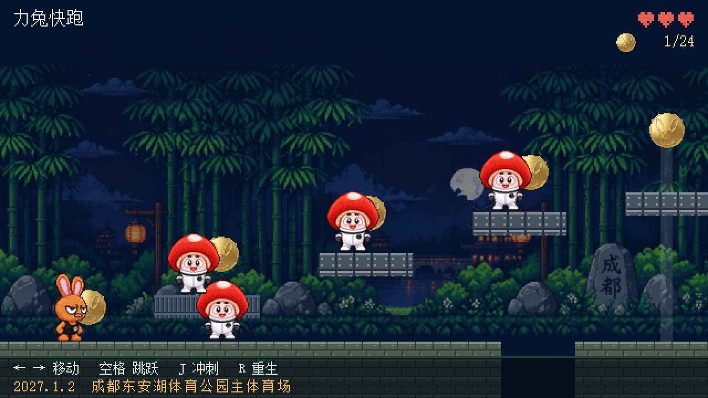
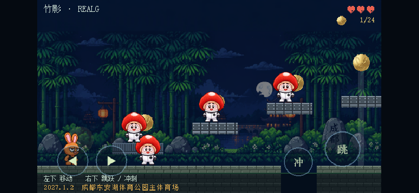
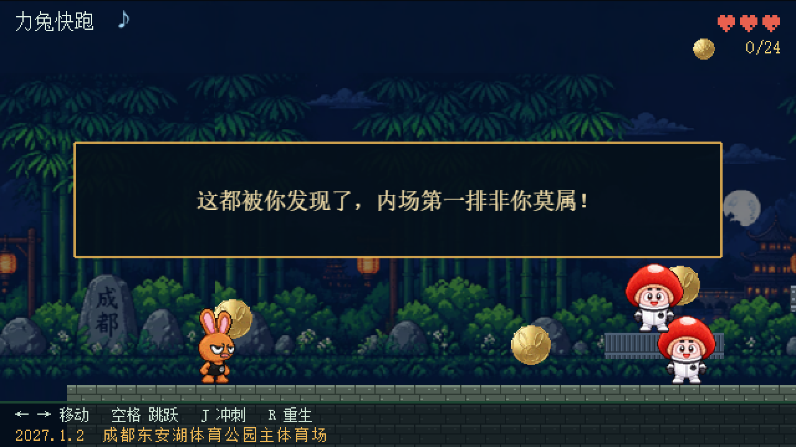
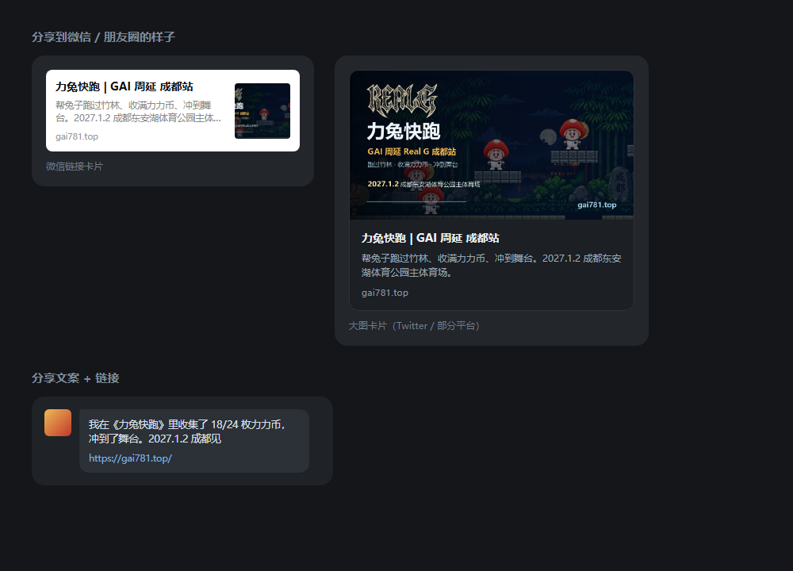

# 力兔快跑

为 **GAI 周延 Real G 成都站演唱会**做的横版预热小游戏。线上地址：**gai781.top**

当前进度 **M2**：跑酷手感 + 蘑菇敌人 + 成都场景 + 演出信息露出。





## 本地运行

```bash
pnpm install
pnpm dev          # http://127.0.0.1:5183
```

构建与预览构建产物：

```bash
pnpm build
node scripts/serve-dist.mjs 4183   # http://127.0.0.1:4183
```

调试参数：

| 参数 | 作用 |
| --- | --- |
| `?sx=1500` | 直接出生在关卡指定横坐标 |
| `?touch=1` | 强制显示虚拟按键（桌面调试用） |
| `?die=1` | 直接进失败结算页 |
| `?egg=1` | 直接触发左墙彩蛋，并传送到隐藏币旁 |

## 启动流程

打开页面时**不会**立刻下载 Phaser，只加载纯 HTML 的启动页：

| 阶段 | 下载内容 | gzip |
| --- | --- | --- |
| 打开页面 | `index.html` + `boot.js` + logo | 约 76 kB |
| 点「开始游戏」 | Phaser + 游戏逻辑 | 约 352 kB |

`src/boot.ts` 负责显示启动页，点击后才 `await import('./main')`，Vite 会把游戏代码拆成独立 chunk。加载期间按钮显示「加载中…」转圈，场景创建完成后派发 `game-ready` 事件，启动页淡出。

调试用 `?autostart=1` 可以跳过启动页直接进游戏。

## 操作

| 动作 | 键盘 | 手机 |
| --- | --- | --- |
| 左右移动 | `←` `→` 或 `A` `D` | 左下 `◀` `▶` |
| 跳跃 | `空格` / `W` / `↑` | 右下 `跳` |
| 冲刺 | `J` / `Shift` | 右下 `冲` |
| 重生 | `R` | — |
| 显示碰撞体 | `F1` | — |

虚拟按键只在真触摸设备出现（同时判断触摸点和 `pointer: coarse`，避免桌面误判）。调试时可以加 `?touch=1` 强制显示。

## 结算与称号

跑到舞台或三条命耗尽都会进结算页。

| 条件 | 称号 |
| --- | --- |
| 收集 100% | 究极盖孝子 |
| 收集 ≥ 80% | 力兔狂热粉 |
| 其余通关 | 沙琪玛 |
| 没跑到终点 | 你这手速能抢到票吗 |

结算页有「再玩一次」和「分享战绩」。分享优先调系统原生分享，不支持时复制文案与链接。

## 分辨率怎么定的

游戏内部分辨率 **640×360**，这个数字是按手机横屏倒推的：

| 设备 | 屏幕 | 实际放大倍数 | 效果 |
| --- | --- | --- | --- |
| iPhone 横屏 | 844×390 | 1.08 倍 | 文字接近 1:1，不会糊 |
| 桌面 720p | 1280×720 | 2.0 倍 | 整数倍，像素均匀 |
| 桌面 1080p | 1920×1080 | 3.0 倍 | 同上 |

如果用 480×270，手机上只能整数放大 1 倍（画面小得没法玩），或者非整数放大 1.7 倍（像素大小不一、发糊）。所以直接提高内部密度，让手机接近 1:1。

竖屏打开会提示横屏，可以点「仍然继续」。

## 玩法规格

- **跑酷**：土狼时间 100ms、跳跃缓冲 120ms、可变跳跃高度、下落加重、空中冲刺
- **战斗**：踩蘑菇头击败，侧面撞到掉 1 心 + 击退 + 1.2 秒无敌；3 心用完重开
- **收集**：24 个力力币
- **敌人**：19 个蘑菇，各自绑定所在平台的巡逻范围（`from` / `to`），到边就转身，不会走进坑里
- **关卡**：约 3867px 长，分四段

| 段 | 范围 | 内容 |
| --- | --- | --- |
| A 热身 | 0–700 | 台阶 + 上下浮动的蒸汽平台 |
| B 工坊 | 700–1700 | 连续小平台 + 滚动传送带 |
| C 断崖 | 1700–2660 | 55px 间隔的连续上下跳，落点只有 60px |
| D 终点 | 2660–2900 | 演唱会舞台 |

地面共 8 段，坑宽 50 / 60 / 70 / 80。最宽的 80 需要在跳跃中接冲刺才能过。

## 美术素材

全部在 `public/assets/`：

| 文件 | 尺寸 | 用途 |
| --- | --- | --- |
| `rabbit.png` | 44×64 | 主角 |
| `mushroom.png` | 54×62 | 蘑菇敌人 |
| `coin.png` | 40×40 | 力力币（得分道具） |
| `logo.png` | 320×153 | 透明底线框 logo，舞台大屏 |
| `bg-loop.png` | 640×360 | 可循环背景，左右无缝 |

处理脚本：

```bash
# 角色：原图有透明通道时直接使用（不会动白色部分）
python scripts/prepare-character.py <原图> public/assets/rabbit.png \
    --height 62 --canvas 44x64

# logo：保留原透明通道，染色并加粗线条
python scripts/prepare-logo.py <原图> public/assets/logo.png --width 320
```

**兔子和蘑菇都只有一张站姿图**，跑动/跳跃/冲刺是靠缩放和倾斜模拟的（`Rabbit.applyProceduralAnim`）。要做真动画需补帧：

| 动作 | 帧数 |
| --- | --- |
| run | 6 |
| jump / fall | 2 + 2 |
| dash | 2 |
| hurt / death | 2 + 4 |

规格：透明 PNG、朝右、脚底贴画布底边。帧数改 `src/config.ts` 的 `RABBIT_FRAMES`。

## 背景

`bg-loop.png` 是一张左右可无缝拼接的循环背景，游戏里用 `TileSprite` 平铺，按相机横向滚动做视差（系数 0.5），并压了一层 42% 的暗色让前景角色跳出来。

没放这张图时，会自动退回代码生成的三层竹林。

## 目录

```
src/
├─ config.ts             # 虚拟分辨率、调色板、物理参数
├─ main.ts               # Phaser 启动配置
├─ gfx/textures.ts       # 蘑菇 / 盖碗茶 / 灯笼 / 地砖 / 占位兔子
├─ entities/Rabbit.ts    # 玩家
├─ entities/Mushroom.ts  # 蘑菇敌人
└─ scenes/GameScene.ts   # 关卡、相机、视差、敌人、HUD
scripts/
├─ prepare-character.py  # 角色图 → 像素 sprite
├─ prepare-logo.py       # 线稿 logo → 透明发光字
└─ serve-dist.mjs        # 零依赖静态服务器
```

## 彩蛋



游戏最左边有一道看不见的墙。**贴着它持续按住左键 2 秒**，兔子会顶穿屏幕走到地图外面——那里藏着第 25 枚力力币。

吃掉后弹出：

> 这都被你发现了，内场第一排非你莫属！

实现要点：

- 触发条件是「贴着左边界 + 按住左方向」累计 2 秒，松开就归零
- 触发后关掉 `setCollideWorldBounds`，并把相机 bounds 放宽到 `-260`，否则相机会把画面卡在 0
- 地图外补了一小段地面（`RAW_SOLIDS` 第一项，x 从 -220 到 0），否则兔子会直接掉进虚空
- 这枚币**不计入 24 枚总数**，纯粹是彩蛋

调试：`?egg=1` 直接触发并传送到币旁边。

## 音效

全部用 Web Audio **现场合成**，没有任何音频文件，打包体积只增加约 2.7 kB。

| 音效 | 触发时机 | 音色 |
| --- | --- | --- |
| `jump` | 起跳 | 方波 330→760Hz 上滑 |
| `land` | 落地（下落速度 > 140） | 三角波 190→90Hz |
| `dash` | 冲刺 | 噪声 + 锯齿波下滑 |
| `coin` | 吃到力力币 | 方波 988→1319Hz 双音 |
| `stomp` | 踩中蘑菇 | 方波 280→70Hz + 噪声 |
| `hurt` | 被撞 | 锯齿波 320→85Hz |
| `win` / `lose` | 通关 / 翻车 | 上行 / 下行琶音 |
| `click` | 结算页按钮 | 短促 720Hz |

左上角标题旁的 `♪` 是静音开关，点一下全局静音。

浏览器有自动播放限制，音频上下文会在第一次点击或按键时才解锁（`GameScene.create` 里挂了 `input.once`）。

想调音色就改 `src/audio/sfx.ts`，每个音效都是一两行参数。

## 分享卡片



分享出去长什么样，取决于页面头部的 OG 标签。`index.html` 里已经按 `gai781.top` 配好：

| 标签 | 内容 |
| --- | --- |
| `og:title` | 力兔快跑 \| GAI 周延 成都站 |
| `og:description` | 帮兔子跑过竹林、收满力力币、冲到舞台… |
| `og:image` | `https://gai781.top/og-image.png`（1200×630，右下角带域名） |
| `og:url` | `https://gai781.top/` |

换域名时改 `index.html` 里 `og:url` 和两处 `og:image` / `twitter:image` 就行。微信、Twitter 这类爬虫只认绝对地址，相对路径抓不到图。

分享图由 `scripts/make-og-image.py` 生成：

```bash
python scripts/make-og-image.py docs/preview.png public/og-image.png public/assets/logo.png
```

改文案、字号、域名位置都在这个脚本里。它会自动裁掉游戏自带的 HUD，只留场景。

分享走 `navigator.share`（手机上会拉起微信/朋友圈那一排），不支持时复制「战绩文案 + 链接」。

## 部署到 Vercel

1. 推到 GitHub；
2. Vercel 导入仓库，框架自动识别 Vite（`vercel.json` 已配好）；
3. Project → Settings → Domains 添加 `game.你的域名`；
4. 域名服务商加 CNAME。

产物：`index.js` 约 25 kB，Phaser 1.48 MB（gzip 340 kB），背景图 298 kB。

## 下一步（M3）

- 音效与 BGM（目前完全静音）
- 川剧变脸版蘑菇
